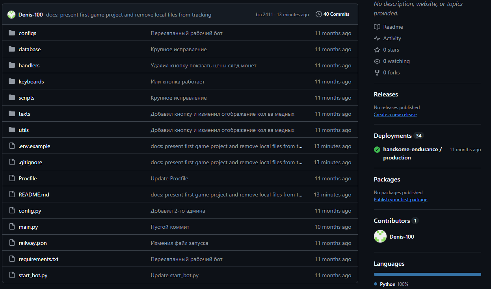
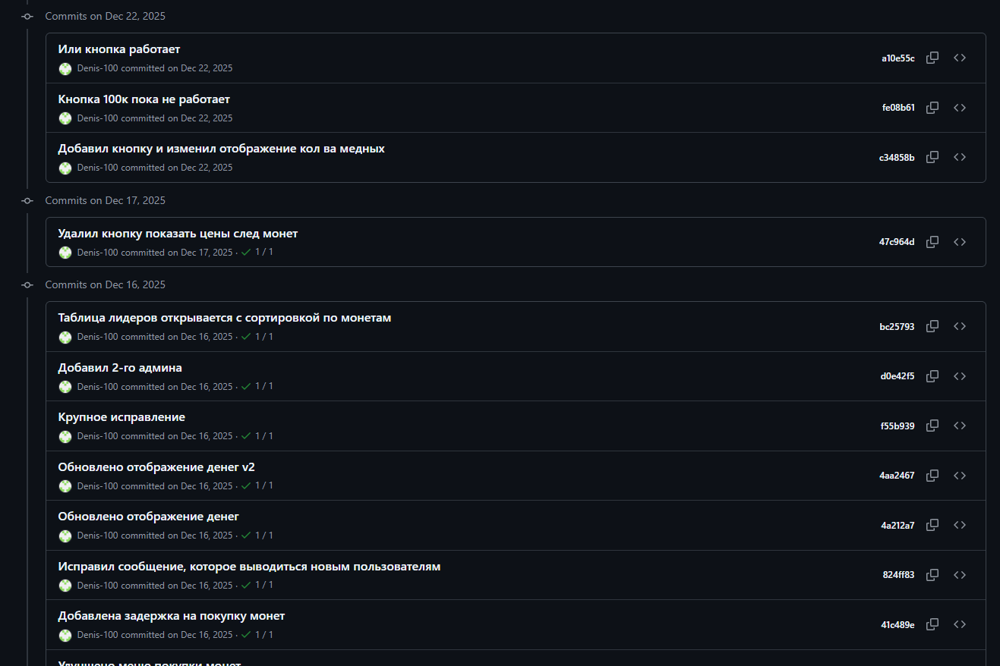

# MergeToGetRich 🪙

**MergeToGetRich** — мой первый личный проект, в котором я попробовал создать собственную игру. Это небольшая экономическая игра в формате Telegram-бота на Python.

## Об игре

Игрок получает первую медную монету бесплатно. Каждая монета приносит доход, за который можно покупать новые монеты. Три одинаковые монеты объединяются в одну следующего уровня — от меди и железа до драгоценных камней и самой редкой монеты.

Цель — постепенно увеличивать доход и добраться до самого высокого уровня монет.

**В игре есть:**
- покупка монет и автоматическое начисление дохода;
- объединение монет и разные уровни редкости;
- профиль с балансом и игровыми активами;
- таблица лидеров;
- меню и кнопки внутри Telegram.

## Скриншоты репозитория до очистки истории

### Главная страница



### История коммитов



*Эти скриншоты сделаны до удаления личных данных из Git-истории. Поэтому указанные на них хеши коммитов могут не совпадать с текущими.*

## Технологии

- **Python**, **aiogram 3**, **asyncio** — логика и интерфейс Telegram-бота;
- **SQLite** (`aiosqlite`) — локальная база данных;
- **PostgreSQL** (`asyncpg`) — вариант базы для размещения бота;
- **Railway** — конфигурация развёртывания.

## Запуск локально

1. Клонировать репозиторий и установить зависимости:

   ```powershell
   git clone https://github.com/Denis-100/TG_Bot_merger_game.git
   cd TG_Bot_merger_game
   pip install -r requirements.txt
   ```

2. Создать своего бота через [BotFather](https://t.me/BotFather) и установить переменные окружения. Пример для **PowerShell** с локальной SQLite:

   ```powershell
   $env:BOT_TOKEN = "YOUR_BOT_TOKEN"
   $env:DATABASE_URL = "sqlite:///users.db"
   $env:ENVIRONMENT = "development"
   python main.py
   ```

Названия настроек приведены также в [`.env.example`](.env.example). В этой версии проекта `config.py` читает **переменные окружения**, а не загружает файл `.env` автоматически.

## О проекте

Это моя **первая попытка сделать игру**. Проект помог мне попробовать асинхронное программирование, работу с Telegram Bot API, базами данных и собственной игровой экономикой. Репозиторий сохранён как результат этого опыта.

## История репозитория

Перед подготовкой репозитория к публикации мне пришлось удалить из истории Git базу данных с личными данными пользователей и файлы с конфиденциальными настройками. Из-за переписывания истории даты коммитов изменились и теперь не отражают реальные даты разработки.

Посмотреть **фактические даты развёртываний проекта** можно в разделе [Deployments](https://github.com/Denis-100/TG_Bot_merger_game/deployments) на GitHub.
